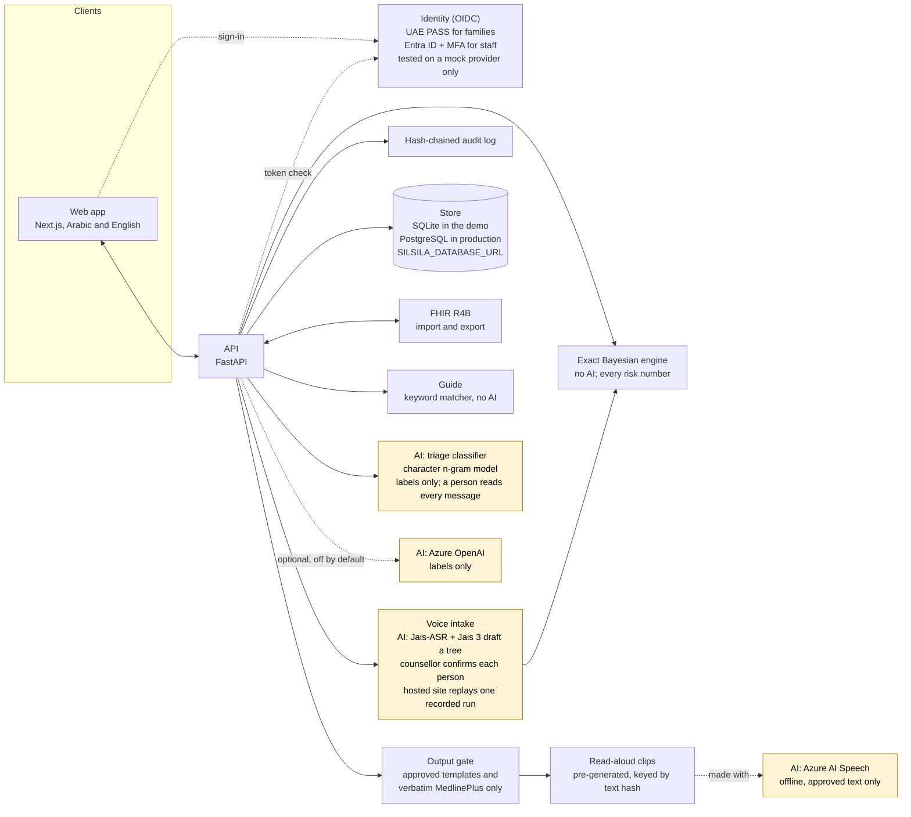

<p align="center"></p>

<h1 align="center">Silsila (سلسلة)</h1>

<p align="center"><strong>Premarital screening protects the next marriage. Silsila protects the marriages that already happened.</strong></p>

<p align="center">
<a href="LICENSE"></a>
<a href="https://github.com/DivineTechie/silsila/actions/workflows/ci.yml"></a>


</p>

**A consent-led family cascade for inherited disease risk.**
Future Health Digital Innovation Challenge 2026 (Abu Dhabi), Fertility, statement 03: *Understanding and
reducing inherited disease risk*.

When one person is found to carry, or to have, a recessive condition (a newborn's genetic screen, an
at-risk premarital result, a diagnosed child), their relatives are much more likely to be carriers too, and
in cousin-marriage families they are often already married to each other. Silsila turns that one result into
private, consent-controlled invitations for the right relatives to be tested, explained in Arabic or English,
checked by a genetic counsellor, and tracked until each case is closed. The person who received the result
decides who is told and how. No name or condition is revealed without their choice.

Prototype with fictional families. Not for clinical use. No patient has used it; the evidence is on
simulated families; the Arabic is machine translation awaiting native clinical review.

## Contents

1. [Links](#links)
2. [For judges: 5 minutes, 15 minutes, 1 hour](#for-judges-5-minutes-15-minutes-1-hour)
3. [Why this matters](#why-this-matters)
4. [How it works](#how-it-works) and [design principles](#design-principles)
5. [Architecture](#architecture)
6. [Evidence](#evidence) and [Silsila-Bench](#silsila-bench-where-language-models-can-be-trusted-inside-silsila)
7. [Run it locally](#run-it-locally)
8. [Project structure](#project-structure)
9. [Technologies used](#technologies-used)
10. [AI tools disclosure](#ai-tools-disclosure)
11. [Production readiness](#production-readiness)
12. [Governance and limitations](#governance)
13. [Licence and third-party content](#licence)

## Links

| Resource | Link | Notes |
|---|---|---|
| Live app | https://silsila-web.lemonisland-568f9acd.uaenorth.azurecontainerapps.io | No password; one-click roles. English and Arabic |
| API health | https://silsila-api.lemonisland-568f9acd.uaenorth.azurecontainerapps.io/api/health | Returns status of the hosted API |
| Demo film (5 min) | https://youtu.be/fCHWTlGyeSY | English; recorded from the live site; synthetic voiceover |
| Source code | https://github.com/DivineTechie/silsila | This repository |
| Submission pack | https://github.com/DivineTechie/silsila/releases/latest | Judge guide, deck PDF, evidence |
| Solution deck | In the submission pack (release asset) | Built from the organisers' template |
| Judges' guide | [`docs/JUDGES.md`](docs/JUDGES.md) | Organised by the six judging criteria |
| Evidence | [`docs/evidence/README.md`](docs/evidence/README.md) | Every number, with the script that produced it |
| Silsila-Bench pre-registration | [`bench_llm/PREREGISTRATION.md`](bench_llm/PREREGISTRATION.md) | Written before the runs; amendments in `AMENDMENTS.md` |
| Hazard log | [`docs/governance/hazard-log.md`](docs/governance/hazard-log.md) | 24 hazards, with controls |
| DoH Responsible AI clause map | [`docs/governance/doh-rai-clause-map.md`](docs/governance/doh-rai-clause-map.md) | Risk class High (3) |
| UAE data rules map | [`docs/governance/uae-data-rules-map.md`](docs/governance/uae-data-rules-map.md) | The team's reading, not legal advice |
| Limitations | [`docs/limitations.md`](docs/limitations.md) | Assumptions and what is not shown |
| Production readiness | [`docs/production.md`](docs/production.md) | What is built for a pilot and what only a pilot can provide |
| Identity (UAE PASS / Entra ID) | [`docs/identity-oidc.md`](docs/identity-oidc.md) | OIDC sign-in, tested against a mock provider |
| Architecture | [`docs/architecture.md`](docs/architecture.md) | Fuller diagrams, including one cascade end to end |
| AI disclosure | [`docs/ai-disclosure.md`](docs/ai-disclosure.md) | Every AI tool used, and what it may not do |

## For judges: 5 minutes, 15 minutes, 1 hour

The full guide by judging criterion is [`docs/JUDGES.md`](docs/JUDGES.md).

| Time | Do this |
|---|---|
| 5 minutes | Open the live app. Press **Watch a cascade** (13 live steps). Open **Family Twin**. Press **Listen** on a relative's link. Ask the guide "Does AI write what families read?" |
| 15 minutes | Add: sign in as Mariam, the counsellor, and the relative (one-click roles); import the FHIR sample (then change `"final"` to `"preliminary"` and see the refusal); read the **Evidence** page; read "What happens when it is wrong" below |
| 1 hour | Add: read the [hazard log](docs/governance/hazard-log.md), the [limitations](docs/limitations.md) and the [Silsila-Bench pre-registration](bench_llm/PREREGISTRATION.md); run the backend tests and benchmarks locally ([Run it locally](#run-it-locally)); open the [evidence records](docs/evidence/README.md) behind any number you doubt |

Detail of what is on the live site (English and Arabic, button in the header; on a phone the page links are in
the menu):

1. **Watch a cascade** (first button on the home page): one newborn's result travelling through a fictional
   family in 13 live steps: exact risk for every relative, Mariam's permission, an anonymous invitation,
   counsellor approval, the relative's private link and comprehension check, the options before or during a
   pregnancy quoted word for word from MedlinePlus (described, never recommended), booking, a pregnancy
   question routed to a person, the test result closing the case, the output gate blocking AI-written
   advice, and the measures for that run. Beside the family tree: what each person sees, and the
   hash-chained audit entries the step created. Each run uses its own fresh copy of the family, and every
   step follows the language you choose, including a switch mid-run.
2. **Family Twin** (top menu): a fictional, simulated five-generation clan of 61 people in 3D. Click anyone,
   record a test result, and watch every relative's exact carrier chance update across six cousin marriages.
   Measured on the hosted server on 16 Nov: 0.7 s with no extra results, a median of 0.9 s (0.7 to 1.2 s)
   once results are recorded, 1.0 s on the first call after a restart; about 0.12 s on a laptop
   ([record](docs/evidence/twin_hosted_timing.json)). Press "Where did it come from?" to see the most likely
   line of descent, or play the cascade race.
3. **A relative receiving a link** (home page role): the anonymous invitation as a relative sees it. Every
   text has a **Listen** button (a synthetic voice, labelled, reading exactly the approved or quoted text, in
   Arabic or English), then common questions answered in quoted source text, a comprehension check and
   booking.
4. **Mariam** (family): newborn screening found classic CAH in her son. She gives permission and invites her
   pregnant sister Noura anonymously.
5. **Genetic counsellor**: the invitation tops the queue because of the pregnancy. Approve it. In **Cases**,
   import an index result from a FHIR R4B record (load the fictional sample, check it, create the case; then
   change `"final"` to `"preliminary"` and see it refused with the reason). In **Voice intake**, a family
   story in Emirati Arabic becomes a draft tree (Jais-ASR, then Jais 3; a recorded run), the counsellor fixes
   what the checks flag, and only then does the engine calculate. **Outcomes** shows the challenge's
   measures (comprehension, uptake, time to counselling, privacy, equity by language) computed live from
   what you just did. Marriages and reproductive choices are never measured as success. "Reset the demo
   data" is in the audit tab.
6. **Evidence** (top menu): every number with its source, the benchmarks, the announced UAE programmes
   Silsila connects to, and a scenario calculator for programme scale.
7. **Ask about Silsila** (button in the bottom corner of every public page): a guide that answers questions
   about the tool. It is not a language model: it matches the words of whatever you type to one of 51 fixed answers (a misspelt word is read as the
   closest one it knows) and, for most, runs a real lookup and shows the values with their sources (try "What is the chance for a cousin
   with thalassaemia?", "Does AI write what families read?", "Where does it run, and how fast is it?"). It
   says so when it has no answer, and it does not answer personal or medical questions.

**Film (one film, English, about five minutes):** animated graphics scenes cut together with a scripted
recording of the live site, with a synthetic voiceover; it names the judging criterion each scene speaks to,
shows the relative's link in Arabic, and is labelled on screen as recorded, fictional and synthetic. The narration and the recording and build
scripts are in [`tools/film/`](tools/film/README.md); the video files are built locally and are not in the
repository. The submission deck is built from the organisers' template by
[`tools/submission/build_deck.py`](tools/submission/build_deck.py), and the text for each submission field is
in [`docs/submission-fields.md`](docs/submission-fields.md).

### The six judging criteria: where to look, what was measured, what is not yet shown

| Criterion | Open | Measured | Not yet shown |
|---|---|---|---|
| Health impact and clinical relevance | Watch a cascade: a newborn's result reaches a pregnant sister | In simulation, Silsila's order found 51 at-risk couples per 1,000 tests against 33 unranked for CAH (ratio 1.53, 95% CI 1.29-1.85); all four published yields of the NEJM 2002 family-screening study fall inside the simulated range | No patients. Yields are projections from simulated families; uptake and comprehension need a pilot |
| Technical depth | Family Twin; Evidence | 30,000 of 30,000 probabilities match an independent exact solver; 0 silent failures in 237 malformed inputs; a pre-registered benchmark of five language models on 150 families | Three genes with published UAE data; other conditions are refused, not estimated |
| Working solution and demo quality | Each role on the home page | Every step runs the real service, from consent to closure with evidence; FHIR import and export; 0 accessibility violations on every screen in English and Arabic (axe-core); 299 backend tests (305 on PostgreSQL) | Voice intake on the hosted site replays one recorded run |
| Responsible AI, safety and data governance | Watch a cascade, steps 10 and 12; [hazard log](docs/governance/hazard-log.md); [DoH RAI clause map](docs/governance/doh-rai-clause-map.md) | 0 disclosures in 10,000 unauthorised requests; crisis-message alert sensitivity 0.961 (95% CI 0.890-0.986) with every message read by a person; read-aloud tied to the exact approved text by hash | Arabic is machine translation, not yet reviewed by a native-speaking clinician; no genetic counsellor has reviewed the templates; no clip has been checked by a native listener |
| Scalability and deployment readiness | Evidence: engine latency; [deployment notes](docs/deployment.md) | Running in Azure UAE North on CPU with no language model at run time; median 173 ms for a 60-person family in the benchmark; 0 errors at 25 concurrent clients on the hosted prototype (382 link opens a second); index results arrive and leave as FHIR R4B | The hosted demo is one replica on SQLite; one replica does about 1.5 full 61-person recalculations a second, so heavy recalculation queues. PostgreSQL storage for several replicas and OIDC sign-in are built and tested ([production readiness](docs/production.md)) but not deployed; UAE PASS itself has not been tested, only a standards-compliant mock |
| Commercial viability and path to pilot | Evidence: announced programmes, scenario calculator; [commercial case](docs/commercial-case.md); [pilot protocol](docs/pilot-protocol.md) | The buyer already produces the index events (565 incompatible couples among 11,748 tested; more than 100 babies identified by newborn screening in the past year; reported figures); 9 practising genetic counsellors in the UAE | No price is validated and no programme has asked for cascade testing; the pilot protocol is a proposal |

## Architecture

Boxes marked **AI** contain a machine-learning model. **AI never decides and never writes to a family**:
risk comes from the exact engine, who is told is the family's choice, and a counsellor approves every
invitation. A fuller version with a sequence diagram of one cascade is in
[`docs/architecture.md`](docs/architecture.md).



## Why this matters

- Testing the extended families of an affected child found 31% of relatives were carriers and 8% of married
  couples were both carriers, versus 0 of 397 people in control families and 0 at-risk couples among 350
  random pregnant couples (Ahmed et al., *NEJM* 2002;347:1162-8, PMID 12374877).
- Abu Dhabi's premarital genetic test (570 genes, 840+ recessive disorders, per the
  [DoH announcement](https://www.doh.gov.ae/en/news/doh-integrates-genetic-testing-as-an-integral-component-of-the-premarital-screening-programme))
  became mandatory for Emiratis in 2024-2025, so couples married before then were never screened. It tested
  11,748 couples from 2022 to July 2026 and found 565 genetically incompatible; the most common conditions
  reported among them included congenital adrenal hyperplasia (the condition in Silsila's demonstration family)
  and thalassaemia (the condition in the Family Twin), and results are exchanged through Malaffi
  ([Gulf News, 3 Oct 2026](https://gulfnews.com/uae/health/abu-dhabi-genetic-screening-flags-565-incompatible-cases-among-couples-1.500697261)).
  The programme is described in the peer-reviewed literature: Al Ameri M, et al. Large-Scale Premarital
  Genetic Screening in the United Arab Emirates. *N Engl J Med* 2026;395(3):306-308,
  [PMID 42456143](https://pubmed.ncbi.nlm.nih.gov/42456143/) (cited from its PubMed record; no figure here
  is taken from it).
- Newborn genomic screening in Abu Dhabi changed the lives of more than 100 babies in the past year,
  according to the DoH chairman
  ([Khaleej Times, 20 Oct 2026](https://www.khaleejtimes.com/uae/abu-dhabi-newborn-genomic-screening-changes-lives-babies)).
  Silsila's demonstration starts from exactly that event: a newborn's result. As a projection, not an observed
  outcome: if 100 index newborns a year each started a cascade for one recessive condition at benchmark B4's
  simulated yields (5 tests per family), Silsila's order would find about 25 at-risk couples (95% interval
  21-31) against 17 unranked for CAH, and 33 (28-37) against 21 for the haemoglobin disorders. The reported
  babies span many conditions, not all recessive, so this shows scale only
  ([`uae_context.json`](docs/evidence/uae_context.json), scenario calculator on the Evidence page).
- The 2026-2031 National Genomics Masterplan (reported 10 Nov 2026) includes personalised genomic reports
  for 900,000 participants through TAMM from December 2026, covering 214 inherited genomic conditions and
  health traits, and nationwide newborn genetic screening (730+ genes, 815+ conditions); the Emirati Genome
  Programme has passed one million participants
  ([The National](https://www.thenationalnews.com/news/uae/2026/11/10/uae-approves-national-genomics-masterplan-to-bring-personalised-medicine-to-all-citizens/)).
  If these reports include carrier findings (the article does not say), every one is a possible index
  result with relatives outside the programme. No announcement of family cascade testing was found, and
  Silsila does not claim DoH has asked for it: it is the step these programmes do not yet describe.
- Half of UAE-national marriages were consanguineous in the only national survey (50.5%, al-Gazali 1997,
  PMID 9881148). Beta-thalassaemia carriers vary from 0% to 13.6% between tribes (Denic 2013, PMID 23600619).

## How it works

| Step | What happens |
|---|---|
| 1. Index result | A newborn screen, premarital result or diagnosis arrives as a FHIR R4B genomics record and is read at counsellor intake: checked first, then confirmed. Names and identifiers in the record are not stored; a record that cannot be read safely is refused with the reason. |
| 2. Family tree and risk | The family enters its tree, including cousin marriages. An exact engine computes every relative's carrier chance and each couple's chance of an affected child. |
| 3. The index person decides | Who is told, and how: a letter they hand over, clinic contact, or an invitation that names no person and no condition. Declining ends the process and is recorded. |
| 4. Counsellor approval | Nothing is sent until a genetic counsellor approves. Pregnancies move to the top of the queue. |
| 5. Relative's view | Only what the index person chose to disclose, sourced information, a comprehension check, and booking. |
| 6. Closure | Each invitation is a case with an owner and closes only with evidence (for example a test result). |

## Design principles

1. **No AI-written advice.** Every sentence a person sees is either quoted word for word from MedlinePlus
   Genetics (US National Library of Medicine, public domain) or an approved procedural template. An output
   gate re-derives each message and blocks anything else. Machine learning only sorts incoming messages, and
   every message is still read by a person.
2. **Nothing made up.** Every population number has a citation with PMID, and conversions are formulas in
   code (`data/params/loci.yaml`). Conditions without published UAE data are deliberately not calculated.
3. **Non-directive.** The system never advises on marriage, pregnancy or termination. Cancelled marriages
   are not a success measure.
4. **Privacy by design.** Granular, revocable consent; relatives see only chosen disclosures; tamper-evident
   audit log; pseudonymous FHIR export; designed for UAE-only hosting.

### What happens when it is wrong

| What could be wrong | What catches it | What was measured |
|---|---|---|
| A relative's carrier or couple chance is wrong (hazard H1) | An exact engine, checked against an independent solver and textbook values | 30,000 of 30,000 probabilities match to within 1e-9; textbook values 67 / 67 |
| A family tree that cannot be right, or results that cannot all be true (H3) | The engine refuses to give numbers and the case goes to the counsellor queue | 0 silent failures in 237 malformed or impossible inputs |
| A tree drafted wrongly from a spoken story (H14, H15) | The counsellor confirms every person and marriage before the engine runs; all problems are listed at once | Silsila-Bench: links found range from 0.8% to 92.5% across the models, which is why a model only drafts |
| A message in distress is missed (H5) | Every message is read by a person, and every reply carries 998/999 | Alert sensitivity 0.961 (95% CI 0.890-0.986); 76/76 replies show 998/999; 100% read by a person |
| A model's text reaches a relative (H4, H17) | No text is generated at run time; an output gate re-derives each message from approved content | Blocked in the live cascade (step 12); the guide made 0 calls to any model; no rate measured for the gate |
| An invitation reaches the wrong person (H6) | Unguessable links, role checks, and relatives see only what was chosen | 0 disclosures in 10,000 unauthorised requests |
| An imported result is preliminary, unsafe or contradictory (H23) | The import reads a record completely or refuses it with the reason, and the refusal is audited | 22 kinds of malformed record and 116 single-field deletions: 0 crashes and 0 silent failures |
| A record is changed afterwards (H10) | A hash-chained audit log that shows the first broken entry | Shown in the demonstration; no rate measured |

Software does not catch everything. People must review the wording of the templates and the Arabic (no
genetic counsellor or native-speaking clinician has yet done so), and relationships that nobody discloses,
such as unrecorded parentage, are invisible to the engine. See the full [hazard log](docs/governance/hazard-log.md).

## Evidence

All evidence is on synthetic data and is reproducible (`docs/evidence/README.md`, per-case logs in
`docs/evidence/logs/`).

| What was tested | Result |
|---|---|
| Engine vs an independent exact solver (pgmpy), 10,000 random consanguineous families | 100% agreement within 1e-9 (30,000 probabilities; max error 5.6e-16) |
| Engine vs textbook values (kinship, Wright's formula, 2/3 sibling risk, residual risk) | 67 / 67 |
| Malformed or impossible inputs | 0 silent failures in 237 (each gets a clear error or counsellor referral) |
| Reproducing NEJM 2002 extended-family yields | All four published figures inside the simulated range |
| At-risk couples found per 1,000 tests (5 tests per family), Silsila ranking vs unranked cascade | HBB 65 vs 41 (ratio 1.58, 95% CI 1.43-1.77); CYP21A2 51 vs 33 (1.53, 1.29-1.85); SMN1 54 vs 35 (1.56, 1.39-1.81) |
| Cascade vs random couple testing | 4.6x (HBB) to about 200x (CYP21A2) more at-risk couples per test |
| Sensitivity to 27 labelled assumptions | Ranking advantage interval above 1 in 16 of 20 settings |
| Crisis messages, blind 400-message test set in English, MSA, Gulf Arabic and Arabizi | Alert sensitivity 0.961 (95% CI 0.890-0.986); 76/76 replies show 998/999; 100% read by a person |
| Unauthorised API requests (14 attack types) | 0 disclosures in 10,000 |
| Arabic translations of quoted text, three independent systems compared | Numbers preserved 76/76; 7 flagged for first clinical review |
| Engine latency, 60-person family with cousin loops | median 173 ms |
| Load on the hosted prototype (one replica, 2 vCPU; client outside the UAE; 30 s per level) | 25 clients at once: relatives opening their links 382 requests/s (median 61 ms, p95 78 ms); guide and home page 245 requests/s (p95 231 ms); 0 errors in about 40,000 requests. The exact 61-person recalculation is the limit: about 1.5 a second on this size, so 8 at once wait a median 6.3 s ([record](docs/evidence/load_hosted.json)) |
| Accessibility, axe-core on every screen (English light desktop, Arabic dark phone) | 0 violations ([record](docs/evidence/accessibility.md)) |
| FHIR import of an index result: 22 kinds of malformed or unsafe record, and each of the sample's 116 fields deleted in turn | 0 crashes and 0 silent failures: each is read, or refused with the reason and audited |
| Readability of the English text a relative can be shown (Flesch-Kincaid grade) | Silsila's own wording 6.9; the quoted MedlinePlus text 13.4, a college reading level, which is why it can be read aloud ([details](docs/evidence/README.md)) |
| Read-aloud clips (synthetic voice, Azure AI Speech), English and Arabic | 74 clips, 33.3 minutes, each attached only to the exact text it reads (SHA-256); none yet checked by a native listener |
| "Ask about Silsila" guide (51 fixed answers, 19 live lookups): every listed question in English and Arabic, 79 questions typed in other words, 3 with misspellings, 8 off-topic and 8 personal or urgent questions | Each reply shows the steps that produced it. Each question reaches its answer, an honest "no answer", or a refusal with the counsellor and 998/999 wording; 0 calls to any model or outside service |
| Family Twin recalculation on the hosted server (61 people, six cousin marriages) | 0.7 s with no extra results; median 0.9 s (0.7-1.2 s) with recorded results ([record](docs/evidence/twin_hosted_timing.json)) |

### Silsila-Bench: where language models can be trusted inside Silsila

Pre-registered ([`bench_llm/PREREGISTRATION.md`](bench_llm/PREREGISTRATION.md), changes in
[`AMENDMENTS.md`](bench_llm/AMENDMENTS.md)); 150 synthetic families, gold answers from the exact engine; models
in a fixed order, not a ranking; 95% intervals from a bootstrap over families. Jais 3 32B was run on a
pre-declared 350-prompt sample (A10). K2-Think-V2 was started on the same sample (A12) but did not finish
within its budget: in 5.5 hours it answered 45 of the 100 free-text prompts; 33 of the 45 gave no number
(reasoning used the whole 32,768-token limit). Of the 12 that gave a number, 6 were exact. That is too few to
score, so it has no row below.

| Model | Free text: exact, of answers given | Free text: no number | With the engine as a tool: exact | Story to tree: links found |
|---|---|---|---|---|
| Jais 3 7B | 59.4% (54-65) | 43.4% | 70.8% (67-75) | 90.9% (88-94) |
| Jais 3 32B (sample) | 95.8% (90-100) | 52.0% | 98.0% (95-100) | 92.5% (87-97) |
| BiMediX2 8B | 5.0% (3-7) | 20.7% | 0.0% | 0.8% |
| Llama3-Med42 8B | 8.4% (6-10) | 0.2% | 3.6% (2-5) | 51.8% (48-55) |
| gpt-oss-120b (frontier reference) | 33.7% (30-38) | 0.0% | 34.4% (29-39) | 91.5% (89-94) |

Every cited PubMed ID was checked: in every model's answers that cited PMIDs, at least one citation did not
support the claim, and 95-100% of the cited IDs that exist belong to unrelated papers
([review](bench_llm/T5_REVIEW.md)). What this decides: no model computes risk in Silsila; models may draft a
family tree from a story, which a counsellor confirms before the exact engine runs. Full tables, splits by
language and family type: [`docs/evidence/silsila_bench.md`](docs/evidence/silsila_bench.md).

## Run it locally

Works on macOS, Linux and Windows. The demo accounts' passwords are not published. Locally they are whatever
you set in `backend/.env` (the example file has placeholders). On the hosted site use the one-click roles.

### Option A: Docker

Requires Docker with Compose.

```bash
# macOS / Linux
cp backend/.env.example backend/.env
```

```powershell
# Windows PowerShell
Copy-Item backend/.env.example backend/.env
```

Edit `backend/.env` and set the two demo passwords and `SILSILA_SECRET`, then:

```bash
docker compose up --build
```

Web: http://localhost:3100. API: http://localhost:8100 (health at `/api/health`).

### Option B: without Docker

Prerequisites: Python 3.12 with [uv](https://docs.astral.sh/uv/), Node.js 22.

Backend (create `backend/.env` first as above):

```bash
cd backend
uv sync
uv run python -m silsila.api.seed
uv run uvicorn silsila.api.app:app --port 8000
```

Web, in a second terminal. The web app reads the API address from `NEXT_PUBLIC_API_URL` at build and start-up
(default `http://localhost:8000`).

```bash
# macOS / Linux
cd web
npm ci
NEXT_PUBLIC_API_URL=http://localhost:8000 npm run dev
```

```powershell
# Windows PowerShell
cd web
npm ci
$env:NEXT_PUBLIC_API_URL="http://localhost:8000"; npm run dev
```

Open http://localhost:3000. Demo users: `mariam` (family, newborn with CAH), `reem` (family, Arabic) and
`counsellor`, with the passwords you set in `backend/.env`.

Suggested walkthrough: sign in as `mariam`, open the family tree, give permission to inform relatives, invite
Noura anonymously; sign in as `counsellor`, see the pregnancy at the top of the queue, approve; open the
invitation link as the relative (switch to Arabic), complete the comprehension check and book; back in the
console, record the result, try the two demonstration tools (blocked unapproved text, audit tampering),
export FHIR, and import the fictional index result in the Cases tab.

### Tests and benchmarks

```bash
cd backend && uv run pytest -q                      # engine, API, evidence tests
cd backend && uv run python -m bench.run_all        # all benchmarks (several minutes)
cd bench_llm && uv sync && uv run pytest -q         # Silsila-Bench harness; mocks, no model calls
cd web && npm ci && npx next typegen && npx tsc --noEmit && npm run lint && npm run build
```

The PostgreSQL store tests (`backend/tests/test_store_postgres.py`) need a reachable PostgreSQL server; see the
file for how they are enabled.

### Production-mode start

Production mode (`SILSILA_DEMO=0`) refuses to start unless the signing secret, the web origin and a PostgreSQL
`SILSILA_DATABASE_URL` are set, and no demo password is. To try it locally with PostgreSQL 17, put
`SILSILA_SECRET` (32+ random characters) and `POSTGRES_PASSWORD` in a `.env` file at the repository root, then:

```bash
docker compose -f docker-compose.prod.yml --env-file .env up --build
```

There are no accounts in production mode: people sign in through an identity provider
([`docs/identity-oidc.md`](docs/identity-oidc.md)). Details: [`docs/production.md`](docs/production.md).

### Deploy to Azure

```bash
az login
bash deploy/azure-deploy.sh      # UAE North, Azure Container Apps; prints the public web and API URLs
```

## Project structure

```
backend/
  src/silsila/
    engine/        Exact pedigree engine: variable elimination, min-fill ordering, Monte Carlo cross-check
    api/           FastAPI service: consent, invitations, queue, audit chain, FHIR R4B import and export,
                   settings and start-up checks, middleware, OIDC sign-in, SQLite/PostgreSQL store, seed data
    sim/           Family simulator (genedrop, kindred, scenarios) and its labelled assumptions
    guide.py       "Ask about Silsila": fixed answers and live lookups; no language model
    triage.py      Message triage: rules, character n-gram model, optional Azure OpenAI labels
    twin.py        Family Twin: the 61-person simulated clan
    content.py     Approved content, MedlinePlus imports, Arabic translations, output gate
    intake.py      Voice intake: draft tree checks before the engine runs
    params.py      Sourced parameter register and conversions
  tests/           pytest suite (engine, sim, API flow, content, FHIR, guide, intake, Twin, store)
  bench/           Five benchmarks on simulated families (B1 to B5) and engine timing
  evals/           Triage training and evaluation, privacy attack evaluation
  scripts/         MedlinePlus import, read-aloud clip generator, readability, load test, audit verification
bench_llm/         Silsila-Bench: pre-registered language-model benchmark (harness, runs, T5 review)
data/
  params/          Sourced population parameters (loci.yaml)
  content/         Approved templates, MedlinePlus text, Arabic translations, read-aloud clips
  demo/            Fictional FHIR sample, Family Twin clan, voice-intake demo, contrast examples
  guide/           The guide's fixed answers
  models/, eval/, dev/, calibration/   Triage model, blind test set, development set, simulator calibration
web/src/           Next.js app: app/ (routes), components/, lib/ (API client, strings, layout)
docs/
  evidence/        Every benchmark record and log
  governance/      Hazard log, model cards, DoH and UAE rules maps
tools/
  film/            Narration, recording and build scripts for the demo film
  submission/      Deck builder from the organisers' template
  translation_qc/  Three-system Arabic translation check
deploy/            Azure deployment script
```

## Technologies used

Versions are from `backend/uv.lock`, `web/package.json` and `web/package-lock.json`.

| Layer | Technology |
|---|---|
| Engine and API | Python 3.12, FastAPI 0.162.0, uvicorn 0.54.0, pydantic 2.14.3, numpy 2.5.4, PyJWT 2.15.1 with cryptography (OIDC token signatures) |
| Interoperability | fhir.resources 8.3.0 (FHIR R4B) |
| Machine learning | scikit-learn 1.9.1 and joblib 1.6.0 (triage n-gram classifier) |
| Storage | SQLite (demo); PostgreSQL through psycopg 3.3.9 with a connection pool (production) |
| Web | Next.js 16.4.5, React 19.3.0, TypeScript 5, Tailwind CSS 4, three.js 0.187.0 (Family Twin), IBM Plex fonts |
| Containers | Docker, Docker Compose; non-root images with health checks |
| Hosting | Azure Container Apps (UAE North), Azure Container Registry |
| Speech | Azure AI Speech neural voices (pre-generated clips and film narration) |
| CI | GitHub Actions: backend tests on SQLite and on PostgreSQL 17, Silsila-Bench harness tests, web lint, types and build, gitleaks secret scan |
| Testing and checks | pytest 9.2.0, hypothesis 6.170.14, pgmpy 1.1.2 (independent exact solver for the cross-check), scipy 1.18.1, axe-core 4.10.2 (accessibility), Playwright 1.61.0 (film recording) |

## AI tools disclosure

**AI does not make any decision in Silsila. Risk is computed by an exact, deterministic Bayesian engine; who is
told is decided by the family; every invitation is approved by a genetic counsellor; no AI-written text reaches
a family member.**

| Tool | Where | What it does | What it is not allowed to do |
|---|---|---|---|
| Azure AI Speech neural voices | Read-aloud clips (`data/content/audio`); demo film narration; voice-intake demo clip | Turns approved or quoted text into audio, ahead of time | Read anything that is not the exact approved text (each clip is tied to its text by SHA-256); run at request time |
| Jais-ASR and Jais 3 7B | Voice intake | Recognises a spoken Emirati Arabic story and drafts a family tree | Calculate risk; reach a family; skip counsellor confirmation of each person. The hosted site replays one recorded run |
| Triage classifier (scikit-learn, character n-grams) | `backend/src/silsila/triage.py` | Labels incoming messages (for example crisis, decision, religious) to order the queue | Write replies; replace a person reading every message. Trained on 800 synthetic messages written by an AI model (Claude) |
| Azure OpenAI (optional, off by default) | `triage.py` | Adds labels to redacted message text | Write text; remove labels set by the rules or the n-gram model |
| Machine translation for Arabic | `data/content`, guide | Arabic versions of approved and quoted text, written at build time by an AI model (Claude), cross-checked with opus-mt-tc-big-en-ar and Azure AI Translator, with LaBSE as a meaning check. The guide's Arabic answers and a few interface labels were machine-translated with Azure AI Translator and corrected by hand for product names | Reach a family unreviewed in a pilot: it awaits native clinical review |
| Language models in Silsila-Bench | `bench_llm/` | Evaluated only: Jais 3 7B and 32B, K2-Think-V2, BiMediX2 8B, Llama3-Med42 8B, gpt-oss-120b | Anything at run time; none is used in the product to compute risk |
| Claude Code (Anthropic) | Development | Coding and writing assistant: code, tests, documentation, film and deck tooling | Set clinical rules or claims: every design decision, clinical rule and claim was reviewed by the author; all evidence figures come from scripts in this repository |

The guide ("Ask about Silsila") is **not** an AI: it is a keyword matcher over 51 fixed answers. Full detail:
[`docs/ai-disclosure.md`](docs/ai-disclosure.md).

## Production readiness

Built for production after a pilot: PostgreSQL storage for several replicas, production-mode start-up checks,
OIDC sign-in ready for UAE PASS and Entra ID, security headers, rate limits, structured logs without personal
data, non-root containers with health checks. What only a pilot can provide: real users and outcomes, a
managed UAE database with encryption at rest, UAE PASS and Entra ID registration (the OIDC code has been tested
against a mock provider, not against UAE PASS), native clinical review of the Arabic, genetic counsellor review
of the templates, and an ADHICS-aligned security review. See [`docs/production.md`](docs/production.md).

## Governance

- [DoH Responsible AI Standard clause map](docs/governance/doh-rai-clause-map.md): risk class High (3) under
  the DoH AI Risk Management Protocol.
- [UAE data rules map](docs/governance/uae-data-rules-map.md): the 2023 human genome law, the 2019 health-data
  law, the data protection law and ADHICS set against what the prototype does and does not do. The team's
  reading of public sources, not a legal assessment.
- [Commercial case and path to pilot](docs/commercial-case.md): buyer, value, pricing model, costs, risks.
- [What exists today, and what Silsila adds](docs/alternatives.md): the family letter, direct contact, digital tools,
  pedigree software and carrier screening, compared on published evidence, with where Silsila is weaker.
- [Accessibility audit](docs/evidence/accessibility.md): axe-core, every screen, English and Arabic, 0 violations.
- [Hazard log](docs/governance/hazard-log.md), [triage model card](docs/governance/model-card-triage.md),
  [voice-intake model card](docs/governance/model-card-voice-intake.md),
  [pilot protocol (DECIDE-AI)](docs/pilot-protocol.md), [deployment notes](docs/deployment.md),
  [assumptions and limitations](docs/limitations.md).

## Licence

Apache-2.0: see [`LICENSE`](LICENSE).

### Third-party content

- MedlinePlus Genetics text: US National Library of Medicine, public domain; quoted verbatim and credited.
- IBM Plex fonts: SIL Open Font Licence.
- Read-aloud clips and film narration: synthetic voices generated with Azure AI Speech.
- All families, messages and people are fictional. No real patient data is used.

| Source | Use | Licence |
|---|---|---|
| MedlinePlus Genetics (NLM) | Verbatim patient information | Public domain; credited "Source: MedlinePlus, National Library of Medicine" |
| Azure AI Speech neural voices (`en-GB-SoniaNeural`, `ar-AE-FatimaNeural`; film: `en-US-AvaMultilingualNeural`) | Read-aloud clips, the voice-intake demo clip and the film narration; always labelled synthetic | Generated with the team's own Azure subscription |
| Published studies (PMIDs in `data/params/loci.yaml`, `data/calibration/`) | Population parameters | Facts cited from the literature |
| Helsinki-NLP opus-mt-tc-big-en-ar | Translation cross-check only | CC-BY 4.0 |
| sentence-transformers/LaBSE | Translation meaning check only | Apache-2.0 |
| Synthetic families, messages and test sets | Demo and evaluation | Generated for this project |

## Status

Prototype submitted to the Future Health Digital Innovation Challenge (November 2026). Not a medical device;
not validated with patients. Arabic text awaits native clinical review, and the read-aloud clips a native
listener. See [limitations](docs/limitations.md).
