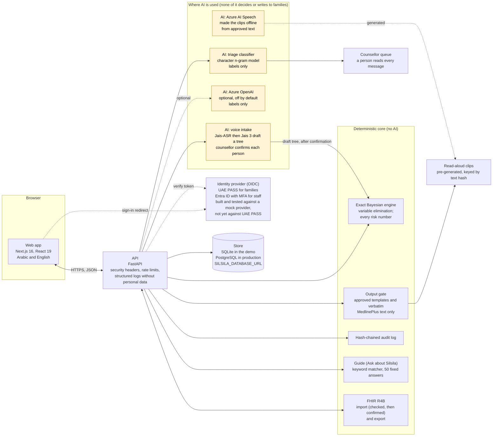

# Architecture

Boxes marked **AI** contain a machine-learning model. AI never decides and never writes to a family: risk
comes from the exact engine, who is told is the family's choice, and a genetic counsellor approves every
invitation. Back to the [README](../README.md).

## Components



Notes:

- The hosted site replays one recorded voice-intake run; it does not call Jais at request time.
- Read-aloud clips are made ahead of time. A clip is served only when the hash of the text on screen equals
  the hash the clip was made from.
- The output gate re-derives every message from approved content; a message that is not in the approved
  set is blocked and the block is audited.
- The store is SQLite for the one-replica demo and PostgreSQL for several replicas. Production mode refuses
  to start without a PostgreSQL URL, a strong secret and explicit web origins.
- Identity: demo accounts use hashed passwords and signed tokens. The OIDC code is described in
  [`identity-oidc.md`](identity-oidc.md).

## One cascade

```mermaid
sequenceDiagram
  autonumber
  actor Fam as Index person (family)
  actor Cou as Genetic counsellor
  actor Rel as Relative
  participant API as API
  participant Eng as Exact engine
  participant Gate as Output gate
  participant Aud as Audit log

  Cou->>API: Import index result (FHIR R4B) and create the case
  API->>Aud: Record import (or refusal with reason)
  Fam->>API: Enter family tree, including cousin marriages
  API->>Eng: Calculate every relative's carrier chance and each couple's risk
  Eng-->>API: Exact probabilities (or refusal if the tree cannot be right)
  Fam->>API: Give permission; choose who is told and how
  API->>Gate: Build the invitation from approved wording
  Gate-->>API: Approved text only (anything else is blocked)
  API->>Cou: Invitation joins the queue (pregnancies first)
  Cou->>API: Approve the invitation
  API->>Aud: Record approval
  API->>Rel: Private link (names no person and no condition unless chosen)
  Rel->>API: Read sourced information, comprehension check
  Rel->>API: Book counselling
  Cou->>API: Record the test result
  API->>Eng: Update the family's probabilities
  Cou->>API: Close the case with evidence
  API->>Aud: Record closure
```

Declining at step 5 ends the process and is recorded. Nothing is sent before step 8.
